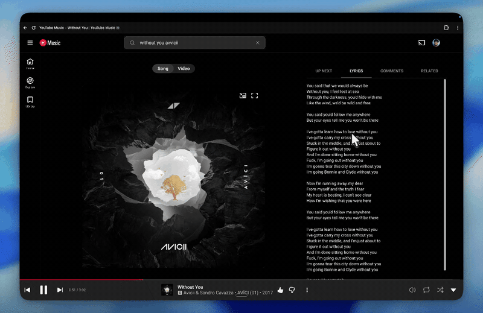

# Animated Lyrics for YouTube Music

**GitHub:** [hgpt185/yt-music-animated-lyrics](https://github.com/hgpt185/yt-music-animated-lyrics)

## Demo



A Chrome extension that turns YouTube Music's plain lyrics panel into Spotify-style animated synced lyrics:

- **Line transitions** — the current line is highlighted, slightly enlarged, and animates in
- **Lyrics auto-scroll** with playback
- **Click any line to seek** the song to that moment
- **Manual scrolling** pauses auto-follow for a few seconds
- **Progress bar** at the top of the lyrics panel
- **Enable/disable toggle** via the extension popup

Timed lyrics come from YouTube Music's own mobile lyrics data when available, then from [LRCLIB](https://lrclib.net) as a fallback.

This works in **Chrome on [music.youtube.com](https://music.youtube.com)** (including the installed Chrome PWA). Google's standalone YouTube Music desktop app does not load Chrome extensions.

## Install

1. Open `chrome://extensions`
2. Enable **Developer mode**
3. Click **Load unpacked**
4. Select this folder (`yt_music_animated_lyrics`)
5. Open YouTube Music, play a song, and open the **Lyrics** tab

Reload the YouTube Music tab after installing or updating the extension.

## How it works

- `background.js` — service worker that fetches timed lyrics (YouTube InnerTube API first, LRCLIB fallback) and caches them per song
- `shared.js` — pure helpers for HTML escaping
- `content.js` — mounts the lyrics panel into YouTube Music's player page, tracks playback, and drives the animations
- `content.css` — panel layout and animation styles
- `popup.html` / `popup.js` — extension popup with an enable/disable toggle (persisted via `chrome.storage`)

## Development

Run the unit tests for the lyrics parsing and karaoke timing helpers:

```
node test/parse.test.js
```
